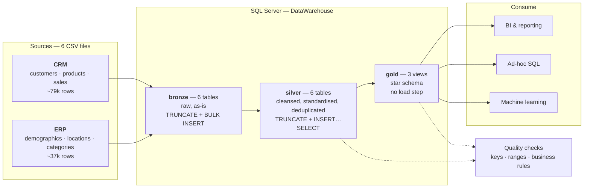
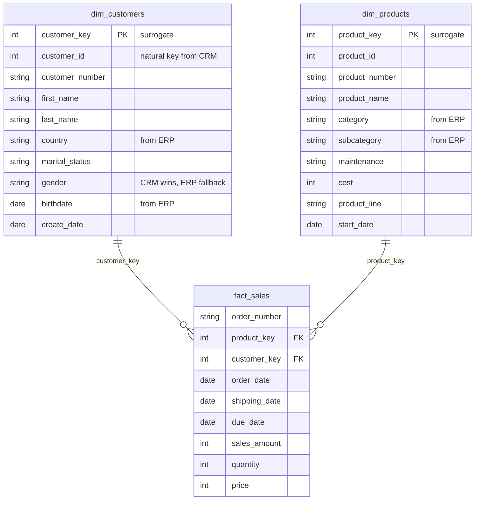

# SQL Server Data Warehouse

A medallion-architecture data warehouse that consolidates two source systems — a CRM and an ERP — into a single star schema for analytics.

The interesting problem here isn't the pipeline. It's that the two systems describe the same customers and products in incompatible ways: different ID formats, overlapping and conflicting attributes, dates stored as integers, and sales figures that don't always agree with quantity × price. Silver is where that gets reconciled.

**~116,000 rows · 6 source files · 2 source systems · 3 layers · SQL Server**

---

## Architecture



### The three layers

| Layer | Objects | Load | Transformations | Purpose |
|---|---|---|---|---|
| **bronze** | 6 tables | `TRUNCATE` + `BULK INSERT` with `TABLOCK` | None | Raw landing. Source column names and types preserved so any cleansing rule can be replayed from scratch. |
| **silver** | 6 tables | `TRUNCATE` + `INSERT…SELECT`, inside a transaction | Trimming, code normalisation, deduplication, key derivation, type conversion, business-rule repair | One trustworthy row per entity. |
| **gold** | 3 views | None — computed on read | Joins, source precedence, surrogate keys | Star schema an analyst can query directly. |

Bronze stays raw deliberately. If a silver rule turns out to be wrong, the original data is still there to rebuild from.

---

## Data model

Gold is a star schema: one fact table of measurements surrounded by dimensions of descriptive attributes.



**Facts are what you measure; dimensions are how you slice it.** `fact_sales` holds the measurements — amount, quantity, price. The dimensions hold everything you'd filter or group by.

Dimensions are denormalised on purpose. ERP category and subcategory are flattened straight into `dim_products` rather than kept in a separate table, which costs some redundancy and buys fewer joins per query. That's the right trade for a read-heavy analytical workload loaded in controlled batches.

---

## What silver actually does

This is where most of the work lives.

### Reconciling identity across systems

The same customer appears under three different ID formats:

| Source | Format | Handling |
|---|---|---|
| CRM `cst_key` | clean | used as the canonical key |
| ERP `CUST_AZ12.cid` | prefixed, e.g. `NASAW00011000` | `SUBSTRING(cid, 4, LEN(cid))` when it starts with `NAS` |
| ERP `LOC_A101.cid` | dashed, e.g. `AW-00011000` | `REPLACE(cid, '-', '')` |

Products needed the reverse. The CRM product key encodes two things at once, so it gets split:

```sql
REPLACE(SUBSTRING(prd_key, 1, 5), '-', '_') AS cat_id,   -- joins to the ERP category table
SUBSTRING(prd_key, 7, LEN(prd_key))        AS prd_key    -- joins to sales
```

### Deduplicating customers

```sql
ROW_NUMBER() OVER (PARTITION BY cst_id ORDER BY cst_create_date DESC) AS flag_last
-- keep flag_last = 1
```

Group rows by customer, order newest-first, keep the first. `DISTINCT` would collapse rows without letting you control which values survive; this makes the choice explicit and deterministic.

### Standardising codes

Single-letter source codes become readable values, with anything unrecognised landing on `'n/a'` rather than `NULL` — so "we looked and nobody knows" is distinguishable from "never populated", and `GROUP BY` results don't grow a blank bucket.

| Column | Source | Silver |
|---|---|---|
| `cst_marital_status` | `S`, `M` | `Single`, `Married`, `n/a` |
| `cst_gndr` / `gen` | `F`, `M` | `Female`, `Male`, `n/a` |
| `prd_line` | `M`, `R`, `S`, `T` | `Mountain`, `Road`, `Other Sales`, `Touring`, `n/a` |
| `cntry` | `DE`, `US`, `USA`, blank | `Germany`, `United States`, `n/a` |

### Building product validity windows

```sql
CAST(LEAD(prd_start_dt) OVER (PARTITION BY prd_key ORDER BY prd_start_dt) - 1 AS DATE) AS prd_end_dt
```

Each product version ends the day before the next one begins. This is slowly-changing-dimension Type 2 construction: silver keeps the full version history with validity ranges. Gold then filters to the current version, because the project scope is current-state reporting — but the history is there if a later requirement needs it.

### Repairing business-rule violations

Sales figures in the source don't always satisfy `sales = quantity × price`:

```sql
CASE WHEN sls_sales IS NULL OR sls_sales <= 0
       OR sls_sales != sls_quantity * ABS(sls_price)
     THEN sls_quantity * ABS(sls_price)
     ELSE sls_sales END AS sls_sales
```

And when price is missing or non-positive it's derived the other way, with `NULLIF(sls_quantity, 0)` turning a zero quantity into `NULL` instead of a divide-by-zero.

These rows are repaired rather than dropped: the transaction genuinely happened, so discarding it would understate revenue.

### Converting integer dates

Dates arrive as integers like `20101229`. Anything that is zero or not eight digits becomes `NULL` rather than failing the cast; the rest become real `DATE` values.

### Audit column

Every silver table carries `dwh_create_date DATETIME2 DEFAULT GETDATE()`, so any row can be traced to the load that produced it.

---

## Resolving conflicts in gold

Both systems store gender, and they don't always agree. `dim_customers` declares the CRM authoritative:

```sql
CASE WHEN ci.cst_gndr != 'n/a' THEN ci.cst_gndr    -- CRM is the system of record
     ELSE COALESCE(ca.gen, 'n/a') END AS gender     -- fall back to ERP
```

This is a governance decision, not a SQL one: two systems hold overlapping truth and something has to be authoritative per field. Encoding it in one place means an analyst never has to wonder which system a value came from.

---

## Quality checks

Two scripts under `tests/`, run after their layer loads.

**`quality_checks_silver.sql`**

| Check | Catches |
|---|---|
| Null or duplicate primary keys | Broken deduplication |
| `col != TRIM(col)` | Whitespace leaking through cleansing |
| Negative or null product cost | Invalid values surviving the load |
| `prd_end_dt < prd_start_dt` | Validity windows built backwards |
| `order_dt > ship_dt` or `> due_dt` | Impossible event ordering |
| `sales != quantity * price` | Business-rule violations the repair missed |
| Birthdates outside 1924–today | Out-of-range demographics |
| `SELECT DISTINCT` on coded columns | Unexpected values after standardisation |

**`quality_checks_gold.sql`**

| Check | Catches |
|---|---|
| Duplicate `customer_key` / `product_key` | Surrogate keys that aren't unique |
| Fact rows with a `NULL` dimension key | Broken referential integrity across the star |

Every check is written to return **no rows** when the data is correct.

---

## Running it

Requires SQL Server and a client (SSMS, Azure Data Studio, or `sqlcmd`).

```sql
-- 1. Create the database and the three schemas
--    WARNING: drops and recreates DataWarehouse if it exists
:r scripts/init_database.sql

-- 2. Create the tables
:r scripts/bronze/ddl_bronze.sql
:r scripts/silver/ddl_silver.sql

-- 3. Load
EXEC bronze.load_bronze;
EXEC silver.load_silver;

-- 4. Create the gold views
:r scripts/gold/ddl_gold.sql

-- 5. Verify
:r tests/quality_checks_silver.sql
:r tests/quality_checks_gold.sql
```

Both load procedures print per-table and total durations and are wrapped in `TRY`/`CATCH`, so a failure reports the message, number, state and line rather than failing silently. The silver load runs inside a transaction, so a failure partway through doesn't leave the layer half-populated.

The `BULK INSERT` paths in `bronze.load_bronze` point at `/project/datasets/...`. Adjust them to wherever the repo sits on the machine running SQL Server.

---

## Repository structure

```
sql-data-warehouse-project/
├── datasets/
│   ├── source_crm/          cust_info · prd_info · sales_details
│   └── source_erp/          CUST_AZ12 · LOC_A101 · PX_CAT_G1V2
├── docs/
│   ├── data_catalog.md      field-level documentation of the gold layer
│   ├── naming_conventions.md
│   └── *.png                architecture and data-flow diagrams
├── scripts/
│   ├── init_database.sql    database + bronze/silver/gold schemas
│   ├── bronze/
│   │   ├── ddl_bronze.sql
│   │   └── proc_load_bronze.sql
│   ├── silver/
│   │   ├── ddl_silver.sql
│   │   └── proc_load_silver.sql
│   └── gold/
│       └── ddl_gold.sql     the three star-schema views
└── tests/
    ├── quality_checks_silver.sql
    └── quality_checks_gold.sql
```

Naming follows `<source_system>_<entity>` in bronze and silver, and `<type>_<entity>` in gold (`dim_`, `fact_`). Full rules in `docs/naming_conventions.md`.

---

## Design decisions

**Gold is views, not tables.** A view is always consistent with silver the moment silver changes — no third load step, no staleness window, no extra storage. At this size the query cost is negligible. The tradeoff is that the joins and the surrogate-key generation recompute on every query, and a view can't be indexed. At a hundred million rows gold would become materialised tables with indexed join keys.

**Full reload, not incremental.** Truncate-and-reload is the simplest thing that is always correct: no drift, no partial-update bugs, no reconciliation. `TRUNCATE` over `DELETE` because it deallocates pages instead of logging every row. Incremental loading would need reliable change tracking in the source, and CSV extracts don't provide it.

**Type 1 behaviour, Type 2 data.** Silver keeps full product version history; gold filters to current versions because the scope is current-state reporting.

---

## Known limitations

These are the next things to fix, listed because they're real:

- **Surrogate keys aren't stable.** `ROW_NUMBER() OVER (ORDER BY cst_id)` inside a view generates the key from row position at query time. Insert a customer with a lower ID and every subsequent key shifts. A surrogate key's whole purpose is to be the identifier that never changes. The fix is materialised dimension tables with an `IDENTITY` column, assigning each key once and looking it up on later loads.

- **Discontinued products orphan their sales.** `dim_products` filters `WHERE prd_end_dt IS NULL`, so a historical sale of a since-discontinued product finds no match and gets a `NULL` product_key. The row survives but points at nothing, and category aggregates quietly exclude it. `quality_checks_gold.sql` detects this; fixing it properly means joining the fact to the product version that was active on the order date.

- **Money columns narrow to `INT` in silver** while bronze declares `DECIMAL(10,2)`. The source data is whole dollars, so nothing is lost today — but the first source that sends cents will truncate silently. Money should be `DECIMAL` with identical precision at every layer.

- **No orchestration.** The procedures are run by hand in order. A scheduler or an orchestrator would own dependency order, retries, and alerting on failure.

- **Quality checks are scripts, not assertions.** They return rows for a human to read rather than failing a build. Wiring them into something that exits non-zero would make them gates rather than reports.

---

## Built with

SQL Server · T-SQL · stored procedures · window functions · star schema modelling

Built by [Ordi Bimvy](https://github.com/ordibimvy) — Computer Science & Data Science, University of Southern Maine.
